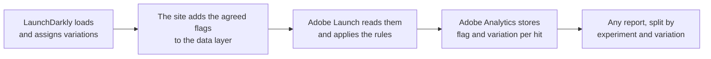

# LaunchDarkly Experiments: Data Layer Specification

**Motion Industries · motion.com · Version 0.1 · Draft for internal review, 2026-11-04. Not yet agreed
with Motion.**

This specification describes how the site tells Adobe Analytics which LaunchDarkly experiences a
visitor was given, so that any Adobe report can be broken down by experiment and variation. It is
written for two readers:

- **Business owners**, who decide which experiments are measured and how results are read. Start
  here, then [How it works](how-it-works.md), [Privacy](privacy.md) and the
  [decisions we need from you](open-questions.md).
- **Developers**, who build it. Read [How it works](how-it-works.md), then the
  [two event pages](#the-two-events) and the [reference pages](#reference).

## In one minute

- **LaunchDarkly decides what each visitor sees.** It assigns every visitor a variation of each flag
  (for example the new or the current header).
- **Today Adobe can't see that assignment**, so Adobe results can't be split by experiment, and the
  counts in LaunchDarkly and Quantum Metric are hard to compare.
- **The site will add the assignment to the data layer** (`window.appEventData`) once LaunchDarkly has
  loaded. Adobe Launch reads it and sends it with every hit.
- **Two things are recorded:** which variation the visitor was **assigned**, on every page, and when
  the visitor was actually **exposed** to the feature.
- **Only an agreed list of flags is sent**, and only the flag name and the variation, never the
  visitor's LaunchDarkly context.

## Why the numbers will differ from LaunchDarkly and Quantum Metric

LaunchDarkly counts **evaluations**: every time the site's code checks a flag. One page can check the
same flag several times, which is why one page view can show as several. This specification counts
**visitors and visits in a variation**, once per hit. Both are correct; they answer different
questions. See [How it works](how-it-works.md).

## How it works, in one picture

## The two events

| Event | What it records | Page |
|---|---|---|
| **Page Loaded** (new `experiments` attribute) | The variation of each agreed flag the visitor is assigned, on every page view | [events/page-loaded-experiments.md](events/page-loaded-experiments.md) |
| **Experiment Exposed** | The visitor actually reached the feature a flag controls, once per flag per page | [events/experiment-exposed.md](events/experiment-exposed.md) |

## Reference

| Page | What's in it |
|---|---|
| [Flag allowlist](reference/flag-allowlist.md) | The flags we send, starting with the site refresh flag |
| [Adobe mapping](reference/adobe-mapping.md) | Which Adobe variables hold what, and the rules for link calls |
| [Privacy](privacy.md) | What is never sent, and the visitor ID consent rule |
| [Open questions](open-questions.md) | The decisions we need before building |
| [Checking a build](checking-a-build.md) | How to test before release |
