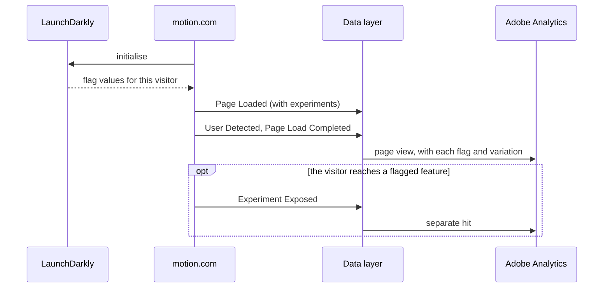

# How it works

[Back to the overview](README.md)

## Assignment and exposure are different things

- **Assignment:** LaunchDarkly has put the visitor in a variation of a flag. It's true from the moment
  LaunchDarkly loads, whether or not the visitor ever reaches the feature. Recorded on **Page Loaded**,
  on every page.
- **Exposure:** the visitor actually reached the part of the site the flag controls (for example the
  product page for a product page test). Recorded by **Experiment Exposed**, when the feature renders.

Comparing results on assignment is the standard way to read an experiment. Exposure tells us how
many assigned visitors actually saw the change, and lets us read results for exposed visitors only.

## What a variation is

LaunchDarkly gives each flag a list of possible values. The **variation** is the position of the
value the visitor was served in that list, starting at 0. For an on/off flag the value is `true` or
`false`. When a flag is switched off, LaunchDarkly serves its "off" value, so the variation already
reflects whether the experience was live for that visitor.

The position is the order the values were defined in each flag, so `0` doesn't mean "on" for every
flag. That's why we send the served **value** as well.

## The page view sequence

**Page Loaded must wait for LaunchDarkly to be ready**, or the first page of a visit carries no flags.
If LaunchDarkly takes too long, send Page Loaded without `experiments` rather than blocking the page.

## Why counts won't match LaunchDarkly or Quantum Metric

| Tool | What it counts |
|---|---|
| LaunchDarkly | Evaluations: each time the code checks a flag. Several per page are normal |
| Quantum Metric | Depends on how it receives flags; it showed about three per page view in testing |
| Adobe (this spec) | Hits, visits and visitors in a variation |

Adobe also counts visitors by its own ID, while LaunchDarkly counts by its visitor key. A visitor who
clears cookies can get a new key and a new assignment. The [checks after launch](checking-a-build.md#after-launch)
measure how often that happens.
