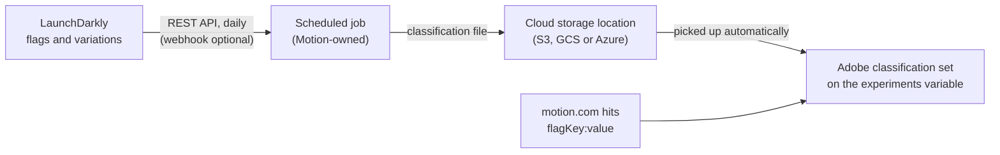

# Keeping flag and variation names current in Adobe

[Back to the overview](../README.md) · For the analytics team and Motion's developers

**Recommendation, draft for internal review, 2026-11-11. Not yet agreed with Motion.**

## The question

Adobe reports should show readable names (experiment name, variation name) next to each flag. The
names live in LaunchDarkly, and Motion's flag list changes often, so the names can't come from a
spreadsheet someone exports by hand. Can Adobe join the hits to a list of flags and variations
that stays current on its own?

## The answer, in short

**Yes.** It needs four pieces, all automatic:

1. **The hit carries the served value, not only the variation number.** Send `flagKey:value`, for
   example `page-brand-refresh:true`. Reports are readable with no lookup at all, and the value
   doesn't change if someone reorders or deletes variations in LaunchDarkly.
2. **A classification rule in Adobe** splits each value at the `:` into *Flag key* and *Value*
   columns. No uploads are needed for this part, so it works even if step 3 fails.
3. **A small scheduled job** reads the flags from the LaunchDarkly REST API once a day and writes a
   classification file (flag name, variation name, experiment or release toggle, owner, status).
   Adobe picks the file up from a cloud storage location on its own.
4. **Optional:** a LaunchDarkly webhook triggers the same job when a flag changes, so new names
   arrive sooner. The daily run stays as the safety net.

Nobody exports or uploads anything by hand. A new variation of a sent flag shows in Adobe from its first
hit (as key and value), and gets its readable name within about a day.

## Why each piece

### 1. Send the value, not only the variation number

LaunchDarkly's browser SDK gives the page the flag key, the served value and the variation number.
It never gives the page the flag's name or the variation's name, so names can only come from
LaunchDarkly's API, not from the site.

The variation number is the variation's position in the flag's list. LaunchDarkly lets editors
delete variations, and its own integration docs store values separately "so applications can perform
stable lookups even if the variation order changes". A label table keyed on the number could
silently attach the wrong name. The value is stable and, for on/off flags, readable on its own.

- **Format:** `flagKey:value`, one per flag, in the experiments list variable
  ([Adobe mapping](adobe-mapping.md)). Each value must stay under Adobe's 255-byte limit.
- **Which flags:** on/off and short text flags only. Flags that serve JSON objects are left out (too
  long, not readable).
- **The data layer doesn't change:** Page Loaded already carries `flagKey`, `variation` and `value`
  ([Page Loaded](../events/page-loaded-experiments.md)). Only the Adobe value format changes.

### 2. Classification rule: key and value with no upload

Adobe's classification sets support rules (split, regular expression) that fill columns from the
value itself. One split rule on `:` gives *Flag key* and *Value* columns for every value seen, with
no file. Rules apply to values seen in the last 1 to 6 months (set per rule).

### 3. The scheduled job: names from LaunchDarkly

| Step | Detail |
|---|---|
| Read | `GET /api/v2/flags/{projectKey}?env=production` with a **Reader** access token (read-only). Each variation returns its `value` and, when set, its `name` and `description`. Page through results (`limit` / `offset`). If LaunchDarkly Experimentation is used, the Experiments API also returns treatment names |
| Build | One row per flag and variation, keyed `flagKey:value` (the column must be named `Key`). Columns: Flag name, Variation name, Type (experiment or release toggle), Tags, Maintainer, Status (live, deprecated, archived) |
| Deliver | Write the file (CSV or TSV, UTF-8) to a cloud location linked to the Adobe classification set (Amazon S3, Google Cloud Storage or Azure). Adobe checks every 15 minutes and imports it. Alternative: Adobe's Classifications API, with an OAuth server-to-server credential |
| Run | Daily, from wherever Motion runs scheduled jobs. A run only needs the LaunchDarkly token and write access to the storage location |

**Experiment or release toggle** comes from LaunchDarkly too: flags with an experiment attached
(`hasExperiment`), flags marked temporary, or a tag Motion agrees on (for example `experiment`).
Analysts then filter Adobe reports to experiments with one click, and release toggles stay out of the way.

**Timing:** Adobe processes classification imports in about 24 hours. Until then a new flag shows
under its key and value (step 2), not as *Unspecified*.

### 4. Webhook (optional)

LaunchDarkly can call a URL whenever a flag changes (scoped to production flags). That call can start
the job. LaunchDarkly retries a failed delivery only once and events can arrive out of order, so the
daily run stays.

## Which flags get sent

The names above stay current on their own, but **which flags the site sends** still follows the
[allowlist](flag-allowlist.md) in the site's code. If Motion wants new experiments captured without a
code change each time, there are two options to discuss with the developers:

- **Send every on/off and short text flag the browser receives.** No list to maintain; the *Type*
  column then lets analysts filter to experiments. To check first: how many flags that is, since every
  hit carries them.
- **Send flags that LaunchDarkly marks as part of a running experiment.** The browser SDK can return
  this (`inExperiment` in the evaluation reason, when reasons are turned on). Only works if Motion
  runs its tests with LaunchDarkly Experimentation ([Open questions](../open-questions.md) #6).

For the site refresh before 12/14, the one-flag allowlist (`PAGE_BRAND_REFRESH`) is enough.

## What we don't recommend

| Option | Why not |
|---|---|
| Manual exports from LaunchDarkly | The flag list changes too often (Phillip, 11/5) |
| Legacy classification importer or FTP | Adobe deprecated the classification importer after 2026-08-31; classification sets don't accept legacy FTP accounts |
| A mapping table in Adobe Launch, or processing rules | Every flag change needs a Launch publish. Processing rules change the stored data and can't be corrected afterwards; classifications can |
| Reading names on the page | The browser SDK doesn't have them |

## Checks before building

| # | Check | Why |
|---|---|---|
| 1 | In Adobe, confirm the chosen list variable can be added to a classification set | Adobe's docs don't state that list variables can be classified. **If not:** classify the exposure list prop instead, or use step 1 alone (key and value are readable without names) |
| 2 | Motion's LaunchDarkly plan allows a Reader access token for an automated job | The job's only LaunchDarkly credential |
| 3 | Where the job runs and who owns it (Motion dev or IT) | It's a small script, but it needs an owner |
| 4 | A cloud storage location Adobe can read, or an Adobe Developer Console project for the API | Delivery path |
| 5 | Whether LaunchDarkly Experimentation is in use | Adds experiment and treatment names; see [Open questions](../open-questions.md) #6 |

## Sources

LaunchDarkly (checked 2026-11-11):
- List flags (variations, filters, paging): https://launchdarkly.com/docs/api/feature-flags/get-feature-flags
- API authentication and versioning: https://launchdarkly.com/docs/api
- Reader role: https://launchdarkly.com/docs/home/account/roles/organization-roles
- Experiments API (treatment names): https://launchdarkly.com/docs/api/experiments/get-experiments
- Webhooks: https://launchdarkly.com/docs/home/infrastructure/webhooks
- Variations (deleting a variation): https://launchdarkly.com/docs/home/flags/variations
- Stable lookups when variation order changes: https://launchdarkly.com/docs/integrations/contentful
- What the browser SDK returns for a flag: https://launchdarkly.com/docs/sdk/features/evaluation-reasons

Adobe (checked 2026-11-11):
- Classification sets (about 24 h processing): https://experienceleague.adobe.com/en/docs/analytics/components/classifications/sets/overview
- Classification set rules (split, regex, lookback): https://experienceleague.adobe.com/en/docs/analytics/components/classifications/sets/manage/rules
- Automated import from a cloud location (15-minute check): https://experienceleague.adobe.com/en/docs/analytics/components/classifications/sets/set/schema
- Cloud location accounts (legacy FTP not available for sets): https://experienceleague.adobe.com/en/docs/analytics/components/locations/configure-import-accounts
- Classification importer deprecation (after 2026-08-31): https://experienceleague.adobe.com/en/docs/analytics/components/classifications/legacy-classifications/classifications-importer/importer-faq
- Classification data files (Key column, encoding): https://experienceleague.adobe.com/en/docs/analytics/components/classifications/sets/data-files
- Classifications API: https://developer.adobe.com/analytics-apis/docs/2.0/guides/endpoints/classifications/
- List variables (255-byte values): https://experienceleague.adobe.com/en/docs/analytics/implementation/vars/page-vars/list
